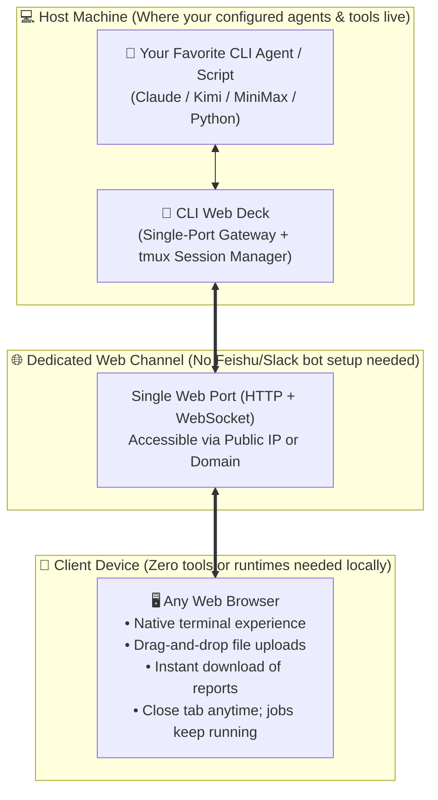

# CLI Web Deck 🚀

<div align="center">

**Turn Any Machine Where Your Favorite CLI Agents Live into a Personal Web Workspace**  
*No need to build complex Feishu, Slack, or WeChat bots. Wherever your tuned CLI agents reside, expose them directly as an elegant, browser-accessible deck.*

[](LICENSE)
[](https://nodejs.org)
[](https://github.com/HankGuo/cli-web-deck/pulls)

**[ 🇺🇸 English ](README.md)** · **[ 🇨🇳 简体中文 ](README.zh-CN.md)**

</div>

---

## 💡 The Core Idea: What Are We Really Doing?

Most developers and power users have a **trusted primary machine** — whether it's a powerful home desktop, an office workstation, or a cloud server. That machine holds your favorite tools, your tuned AI CLI agents (like Claude Code, Kimi CLI, MiniMax Code, Aider, Python analysis scripts), your environment variables, and your secret API keys.

When you are away from that machine (traveling with a light laptop, on an iPad, or working at another client PC), how do you reach your powerful tools?
* **Traditional Bot Integration (Feishu / Slack / WeChat)**: You have to register enterprise developer accounts, configure webhooks, handle message schemas, and live with clumsy file transfers and text-only limits.
* **Heavy Remote Desktops / VNC**: Laggy, bloated, and inconvenient for keyboard-first CLI workflows.

### The CLI Web Deck Approach
**“Expose an instant, dedicated Web Channel for the CLI agents living on your machine.”**

Run `cli-web-deck` on the machine where your agents already live, and it turns that environment into an elegant web deck:
* **No Bot Hassle**: No third-party IM developer accounts, no webhook headaches.
* **Native Terminal Power**: A full-featured browser terminal supporting rich keyboard shortcuts, cursor controls, and streaming responses.
* **Bidirectional Drag-and-Drop**: Drag datasets and documents from your current laptop directly into the browser to feed your remote agent. Download generated reports and outputs with a single click.
* **Session Persistence (`tmux`)**: Close your laptop lid or disconnect Wi-Fi anytime. Your long-running model reasoning or batch scripts keep running in the background.

---

## 🗺️ Conceptual Architecture & Workflow

```
┌────────────────────────────────────────────────────────────────────────┐
│  💻 The Machine Where Your Agents Live (Home PC, Workstation, Server)   │
│                                                                        │
│   🤖 Your Tuned CLI Agents & Environments                              │
│      [ Claude Code ]  [ Kimi CLI ]  [ MiniMax ]  [ Aider ]  [ Python ] │
│                         │                                              │
│                         ▼                                              │
│   🚢 CLI Web Deck (Lightweight Bridge)                                 │
│      • tmux session persistence (never drops background jobs)          │
│      • Single-port gateway (terminal WebSocket + bidirectional files)  │
└─────────────────────────┬──────────────────────────────────────────────┘
                          │ 🌐 Dedicated Web Channel (Single port, IP or Domain)
                          ▼
┌────────────────────────────────────────────────────────────────────────┐
│  📱 Any Device with a Modern Browser (Laptop, iPad, Any Workstation)   │
│                                                                        │
│   🖥️ Modern Web Deck Interface                                         │
│      • Full terminal interaction from anywhere                         │
│      • Drag-and-drop file upload directly to remote workspace          │
│      • Instant one-click downloads for output artifacts                │
└────────────────────────────────────────────────────────────────────────┘
```

### Visual Flow (Mermaid)



---

## ⚡ Comparison: Why Is It Better?

| Dimension | Remote Desktop (VNC/RDP) | IM Bots (Feishu / Slack / WeChat) | 🌟 CLI Web Deck |
| :--- | :--- | :--- | :--- |
| **Setup Cost** | Heavy client installation | Complex developer portals, webhooks, auth | **Zero setup**: One command to launch |
| **Interaction** | Slow, blurry, heavy bandwidth | Limited to chat cards; no full terminal | **Full terminal fidelity**: fast, crisp, keyboard-first |
| **File Transfer** | Requires separate SFTP/shared folders | Strict file size limits & cloud storage hops | **Drag-and-drop directly into browser**; 1-click downloads |
| **Port & Network** | Often needs multiple open ports | Requires fixed public domain & HTTPS | **Single port multiplexing** (direct IP or domain) |
| **Persistence** | Disconnecting can kill active shell | Relies on external bot timeout limits | **tmux backend**: close tab anytime, tasks run 24/7 |

---

## 🚀 Quickstart

### 1. Prerequisites (On the Host Machine)
Ensure `tmux`, `ttyd`, and `Node.js (v18+)` are installed on the host where your CLI tool lives:
```bash
# Ubuntu / Debian
sudo apt update && sudo apt install -y tmux ttyd curl

# macOS
brew install tmux ttyd
```

### 2. Launch Your Web Deck
```bash
git clone https://github.com/HankGuo/cli-web-deck.git
cd cli-web-deck
chmod +x ./bin/cli-web-deck

# 1. Expose your standard bash shell
./bin/cli-web-deck --cmd "bash" --port 8080

# 2. Expose an AI Agent (e.g. Kimi or Claude) with a dedicated workspace
./bin/cli-web-deck --cmd "kimi" --port 8010 --workspace ~/my-workspace

# 3. Add password authentication for public-facing access
./bin/cli-web-deck --cmd "python3 -m IPython" --port 8888 --auth "admin:myPassword123"
```

Open `http://<HOST_IP_OR_DOMAIN>:8080` on any device to start using your agents.

---

## ⚙️ Options & Flags

| Flag | Shorthand | Description | Default |
| :--- | :--- | :--- | :--- |
| `--cmd` | `-c` | The CLI command to run in terminal | `$SHELL` |
| `--port` | `-p` | Public port for the Web Deck (single-port) | `8080` |
| `--workspace` | `-w` | Directory for file uploads and outputs | Current working dir |
| `--title` | `-t` | Title displayed in the browser header | `"CLI Web Deck"` |
| `--auth` | `-a` | Basic Auth credentials (`user:password`) | `None` (Public) |
| `--session` | `-s` | Underlying tmux session identifier | Auto-generated |
| `--host` | `-h` | Network interface to bind | `0.0.0.0` |

---

## 🐳 Docker Deployment (Optional)

```bash
docker build -t cli-web-deck .
docker run -d -p 8080:8080 -v $(pwd)/workspace:/workspace cli-web-deck
```

Or using Docker Compose:
```bash
docker compose -f templates/docker-compose.yml up -d
```

---

## 🛡️ Production Nginx Reverse Proxy

A production-ready reverse proxy config is provided in `templates/nginx.conf`:
```nginx
server {
    listen 80;
    server_name console.yourdomain.com;
    client_max_body_size 500M;

    location / {
        proxy_pass http://127.0.0.1:8080;
        proxy_http_version 1.1;
        proxy_set_header Upgrade $http_upgrade;
        proxy_set_header Connection "upgrade";
        proxy_set_header Host $host;
        proxy_buffering off;
        proxy_read_timeout 86400s;
    }
}
```

---

## ⚠️ Security Notice & Disclaimer

* **Credentials**: When exposing CLI Web Deck over public networks, always enable `--auth "user:pass"` or deploy behind a reverse proxy with TLS/HTTPS encryption.
* **Disclaimer**: CLI Web Deck is an open-source tool released under the MIT License, created to provide convenient web access to existing CLI environments. Users are responsible for complying with their local network and data policies when making services accessible remotely.

---

## 📄 License

MIT License © 2026 HankGuo
