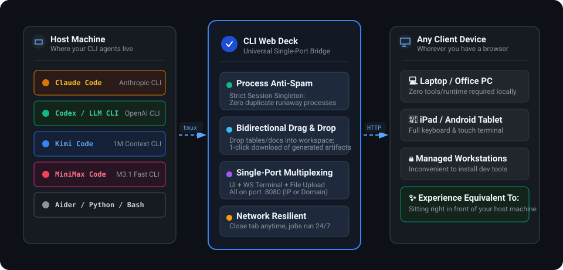

# CLI Web Deck 🚀

<div align="center">

**Turn Any Machine Where Your Favorite CLI Agents Live into a Personal Web Workspace**  
*No need to build complex Feishu, Slack, or WeChat bots. Wherever your tuned CLI agents reside, expose them directly as an elegant, browser-accessible deck.*

[](LICENSE)
[](https://nodejs.org)
[](#-os-support-matrix)
[](https://github.com/HankGuo/cli-web-deck/pulls)

**[ 🇺🇸 English ](README.md)** · **[ 🇨🇳 简体中文 ](README.zh-CN.md)**

<br/>



</div>

---

## 💡 The Core Idea: What Are We Really Doing?

Most developers and power users have a **trusted primary machine** — whether it's a powerful home desktop, an office workstation, or a cloud server. That machine holds your favorite tools, your tuned AI CLI agents:
* **Claude Code** (Anthropic's official autonomous coding agent)
* **Codex / LLM CLI** (OpenAI & local model command lines)
* **Kimi Code** (Moonshot's 1M-context agent)
* **MiniMax Code** (Rapid artifact and scripting agent)
* **Aider / IPython / Data Shells**

When you are away from that machine (traveling with a light laptop, on an iPad, or working at a restricted office client PC), how do you reach your powerful tools?
* **Traditional Bot Integration (Feishu / Slack / WeChat)**: You have to register enterprise developer accounts, configure webhooks, handle message schemas, and live with clumsy file transfers and text-only limits.
* **Heavy Remote Desktops (VNC / RDP)**: Laggy, bloated, and inconvenient for keyboard-first CLI workflows.

### The CLI Web Deck Approach
**“Expose an instant, dedicated Web Channel for the CLI agents living on your machine.”**

Run `cli-web-deck` on the machine where your agents already live, and it turns that environment into an elegant web deck:
* **No Bot Hassle**: No third-party IM developer accounts, no webhook headaches.
* **Native Terminal Power**: Full-featured browser terminal supporting rich keyboard shortcuts, cursor controls, ANSI colors, and real-time streaming tokens.
* **Bidirectional Drag-and-Drop**: Drag datasets and documents from your current laptop directly into the browser to feed your remote agent. Download generated reports and outputs with a single click.
* **Session Persistence (`tmux`)**: Close your laptop lid or disconnect Wi-Fi anytime. Your long-running model reasoning or batch scripts keep running in the background.

---

## ⚡ Architectural Advantages (Addressing Common Engineering Concerns)

CLI Web Deck is engineered for production reliability and long-running background tasks:

### 1. Strict Session Singleton (Prevents Process Spawning Out of Control)
* **Common Worry**: If users open multiple browser tabs or repeatedly hit refresh (F5), will the server spawn dozens of duplicate agent processes, exhausting CPU and memory?
* **Architectural Guarantee**: `cli-web-deck` enforces a **strict session singleton mechanism**. Each port and workspace is tightly coupled to a named `tmux` session. Whether you open 1 tab or 10 tabs, every connection attaches to the *same living backend session*. **Zero duplicate processes are spawned**, completely preventing memory leaks or server crashes.

### 2. Single-Port Full Multiplexing
* Terminal WebSocket streaming, static web UI, file streaming uploads, and file downloads are all multiplexed onto **ONE single HTTP port** (e.g. `8080`).
* No complicated firewall approvals or multi-port routing rules. Works out of the box with raw server IPs or behind standard Nginx / Caddy / Cloudflare setups.

### 3. Streaming File I/O
* File uploads stream directly to disk without loading entire payloads into Node.js memory buffers, effortlessly handling large data files without triggering out-of-memory (OOM) errors.

---

## 💻 OS Support Matrix

To ensure transparency and stability across operating systems:

| Platform / OS | Status | Notes & Recommendations |
| :--- | :--- | :--- |
| **Linux (Ubuntu, Debian, CentOS, Arch, Alpine)** | **Verified & Recommended** | Primary production target. Native package availability for `tmux` and `ttyd`. |
| **macOS (Apple Silicon M-Series & Intel)** | **Verified & Recommended** | Fully tested on macOS Sonoma / Ventura. Install dependencies in seconds via `brew install tmux ttyd`. |
| **Windows + WSL2 (Linux Subsystem)** | **Recommended for Windows** | 100% compatible. Runs identically to native Linux under WSL2. Highly recommended on Windows. |
| **Windows + Docker Desktop** | **Recommended for Windows** | 100% compatible. Fully containerized with all POSIX dependencies included. |
| **Native Windows (PowerShell / CMD)** | **⚠️ Experimental & Untested** | CLI Web Deck relies on POSIX PTY and `tmux` primitives. **It has NOT been tested in native Windows CMD/PowerShell environments without WSL**. Windows users should run via **WSL2** or **Docker**. |

---

## 🚀 Quickstart

### 1. Prerequisites (On the Host Machine)
Ensure `tmux`, `ttyd`, and `Node.js (v18+)` are installed on the host where your CLI tool lives:
```bash
# Ubuntu / Debian / WSL2
sudo apt update && sudo apt install -y tmux ttyd curl

# macOS
brew install tmux ttyd
```

### 2. Launch Your Web Deck
```bash
git clone https://github.com/HankGuo/cli-web-deck.git
cd cli-web-deck
chmod +x ./bin/cli-web-deck

# 1. Launch Claude Code in its workspace
./bin/cli-web-deck --cmd "claude" --port 8080 --workspace ~/projects/ai-work

# 2. Launch Kimi Code or MiniMax Code
./bin/cli-web-deck --cmd "kimi" --port 8010 --workspace ~/kimi-workspace

# 3. Launch interactive Python with password authentication
./bin/cli-web-deck --cmd "python3 -m IPython" --port 8888 --auth "admin:myPassword123"
```

Open `http://<HOST_IP_OR_DOMAIN>:8080` on any device to start using your agents.

---

## ⚙️ Options & Flags

| Flag | Shorthand | Description | Default |
| :--- | :--- | :--- | :--- |
| `--cmd` | `-c` | The CLI command to run in terminal (`claude`, `kimi`, `bash`, etc.) | Current `$SHELL` |
| `--port` | `-p` | Public port for the Web Deck (single-port multiplexing) | `8080` |
| `--workspace` | `-w` | Directory for file uploads and outputs | Current working dir |
| `--title` | `-t` | Title displayed in the browser header | `"CLI Web Deck"` |
| `--auth` | `-a` | Basic Auth credentials (`user:password`) | `None` (Public) |
| `--session` | `-s` | Underlying tmux session identifier | Auto-generated |
| `--host` | `-h` | Network interface to bind | `0.0.0.0` |

---

## 🐳 Docker Deployment (Optional)

```bash
docker build -t cli-web-deck .
docker run -d -p 8080:8080 -v $(pwd)/workspace:/workspace cli-web-deck
```

Or using Docker Compose:
```bash
docker compose -f templates/docker-compose.yml up -d
```

---

## 🛡️ Production Nginx Reverse Proxy

A production-ready reverse proxy config is provided in `templates/nginx.conf`:
```nginx
server {
    listen 80;
    server_name console.yourdomain.com;
    client_max_body_size 500M;

    location / {
        proxy_pass http://127.0.0.1:8080;
        proxy_http_version 1.1;
        proxy_set_header Upgrade $http_upgrade;
        proxy_set_header Connection "upgrade";
        proxy_set_header Host $host;
        proxy_buffering off;
        proxy_read_timeout 86400s;
    }
}
```

---

## ⚠️ Potential Risks, Security Advisory & Disclaimer

Before exposing services to remote networks, please consider the following security practices:

1. **Privilege Isolation (Never Run as Root)**:
   * The terminal runs with the exact OS permissions of the user starting `cli-web-deck`.
   * **Never run `cli-web-deck` as `root` in public or shared environments**. Create a dedicated, non-privileged system user (e.g. `agent-user`) with restricted directory permissions.
2. **Public Network Protection (Strong Auth & TLS)**:
   * If binding to `0.0.0.0` with a public IP or domain, **always enforce `--auth "user:pass"` with a strong password**, or place the deck behind a reverse proxy configured with SSL/TLS certificates.
   * Avoid unencrypted HTTP over the open Internet to protect sensitive commands and uploaded files.
3. **Compute & API Quotas**:
   * Autonomous AI agents (like Claude Code, Aider, etc.) running in loops can consume significant CPU cycles or accrue third-party LLM API token costs. Configure budget caps and max step limits in your agent's configuration files.
4. **MIT Disclaimer**:
   * This project is open-source software provided under the [MIT License](LICENSE).
   * Users are solely responsible for ensuring compliance with their organization's IT and data governance policies. The authors assume no liability for misuse, unauthorized access, or data loss.

---

## 📄 License

MIT License © 2026 HankGuo
