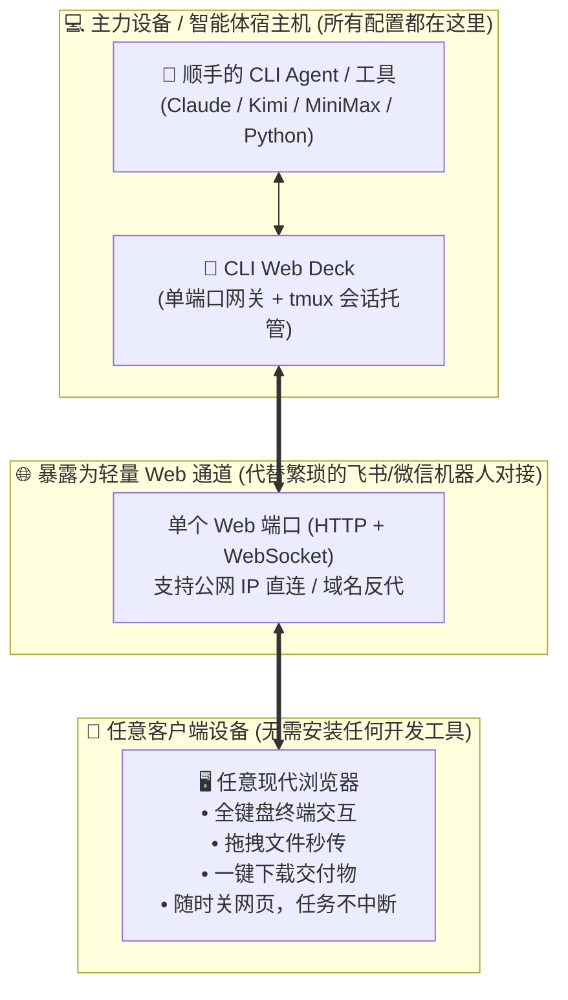

# CLI Web Deck 🚀

<div align="center">

**把你在任何电脑上顺手的 CLI 与 AI 智能体，直接暴露为一个属于你的 Web 工作台**  
*无需对接飞书、微信或复杂的机器人通道，只要有浏览器，就能直接调遣你在主力机上配置好的智能体。*

[](LICENSE)
[](https://nodejs.org)
[](https://github.com/HankGuo/cli-web-deck/pulls)

**[ 🇺🇸 English ](README.md)** · **[ 🇨🇳 简体中文 ](README.zh-CN.md)**

</div>

---

## 💡 核心设计思想：我们在做什么？

你平时肯定有一台**配置最顺手、工具最齐全、API Key 和脚本都在的主力电脑**（可能是家里的高配台式机、办公室的主力工作站，或是自己的云主机）。上面跑着你调教好的各种优秀 CLI 工具与 AI 智能体（如 Claude Code、Kimi CLI、MiniMax Code、Aider、各种 Python 数据分析脚本等）。

平时想在其他设备（出差本、平板、随手借用的电脑）上使用这套顺手的能力时，传统的做法是：
* 给它对接一个**飞书机器人、微信公众号或 Slack Bot** —— 但接入流程繁琐、消息格式受限、不能直接全屏交互，且大文件上传下载极其麻烦；
* 或者开一套笨重缓慢的远程桌面 / VNC。

### CLI Web Deck 的解法
**“等同于为你主力机上的 CLI Agent，暴露一个专属的纯净 Web 通道。”**

你顺手的 Agent 在哪台电脑上，运行一次 `cli-web-deck`，就能把该环境直接化为一个极简、高颜值的 Web 页面：
* **免去 IM 机器人对接**：不用去飞书/微信开放平台申请复杂的开发者账号和 Webhook；
* **完整的原生交互体验**：浏览器里就是全功能终端，支持全键盘快捷键、光标移动；
* **双向文件无感流转**：把数据表格从手头的电脑直接**拖入浏览器**，远端 Agent 就能读取；Agent 算好的分析报告在侧边栏**一键下载**；
* **tmux 底层守护**：随时合上笔记本屏幕下班，远端大模型任务照样跑，换台设备打开浏览器无缝接着聊。

---

## 🗺️ 架构与场景示意图

```
┌────────────────────────────────────────────────────────────────────────┐
│  💻 你的主力电脑 / 服务器 (环境最顺手、工具和密钥都在的地方)          │
│                                                                        │
│   🤖 你调教好的 CLI 智能体与工具链                                     │
│      [ Claude Code ]  [ Kimi CLI ]  [ MiniMax ]  [ Aider ]  [ Python ] │
│                         │                                              │
│                         ▼                                              │
│   🚢 CLI Web Deck (轻量宿主桥接)                                       │
│      • tmux 会话守护 (网络中断不掉线)                                  │
│      • 单端口网关 (终端 WebSocket + 文件双向传输合二为一)              │
└─────────────────────────┬──────────────────────────────────────────────┘
                          │ 🌐 专属 Web 通道 (单个端口，IP 或域名均可访问)
                          ▼
┌────────────────────────────────────────────────────────────────────────┐
│  📱 任意能打开浏览器的设备 (出差轻薄本 / 平板 / 随手使用的电脑)        │
│                                                                        │
│   🖥️ 现代浏览器 Web Deck 控制台                                        │
│      • 像面对面一样操作你的终端智能体                                  │
│      • 拖拽文件到网页即传至远端                                        │
│      • 侧边栏点一下即可下载生成的报表与产出物                          │
└────────────────────────────────────────────────────────────────────────┘
```

### 流程示意 (Mermaid)



---

## ⚡ 为什么比传统方式更舒服？

| 对比维度 | 传统远程方案 (SSH/VNC) | 对接飞书/微信机器人 | 🌟 CLI Web Deck |
| :--- | :--- | :--- | :--- |
| **上手门槛** | 需安装专门客户端，配置复杂 | 需申请企业开发者应用、配置回调与鉴权 | **零配置**：一条命令即启，浏览器即开即用 |
| **交互能力** | VNC 笨重卡顿；SSH 无法传文件 | 仅限图文卡片，不支持实时流式终端操作 | **完整终端交互**，键盘快捷键、光标全支持 |
| **文件流转** | 需额外开 SFTP/SCP，操作琐碎 | 上传附件受限，经常需要中转存储桶 | **直接拖拽入浏览器**，侧边栏一键下载产出物 |
| **网络端口** | 往往需暴露多个端口 | 必须公网固定域名与 HTTPS 证书 | **单端口复用**，裸 IP 或域名均可，防火墙友好 |
| **任务保活** | 终端断开任务往往直接中断 | 依赖外部平台消息超时机制 | **tmux 底层守护**，下班合盖后台持续运行 |

---

## 🚀 极速上手

### 1. 宿主机准备
只需在放有你 Agent 的机器上确保已安装 `tmux`、`ttyd` 与 `Node.js (v18+)`：
```bash
# Ubuntu / Debian
sudo apt update && sudo apt install -y tmux ttyd curl

# macOS
brew install tmux ttyd
```

### 2. 启动你的 Web 通道
```bash
git clone https://github.com/HankGuo/cli-web-deck.git
cd cli-web-deck
chmod +x ./bin/cli-web-deck

# 1. 把顺手的 Bash 终端直接变成网页
./bin/cli-web-deck --cmd "bash" --port 8080

# 2. 把指定的 AI Agent (如 Kimi / Claude) 暴露为独立工作台，指定工作目录
./bin/cli-web-deck --cmd "kimi" --port 8010 --workspace ~/my-workspace

# 3. 暴露给外部访问时，开启账号密码防护
./bin/cli-web-deck --cmd "python3 -m IPython" --port 8888 --auth "admin:myPassword123"
```

在任意设备的浏览器中输入 `http://<机器IP或域名>:8080`，即可开始使用。

---

## ⚙️ 参数选项速查

| 参数 | 缩写 | 作用说明 | 默认值 |
| :--- | :--- | :--- | :--- |
| `--cmd` | `-c` | 需要暴露的终端命令（如 `kimi`、`bash`、`python` 等） | 当前系统的 `$SHELL` |
| `--port` | `-p` | 浏览器访问的 Web 端口（单端口复用） | `8080` |
| `--workspace` | `-w` | 关联的工作区目录（上传文件与产出保存于此） | 当前运行目录 |
| `--title` | `-t` | 浏览器顶部栏显示的标题名称 | `"CLI Web Deck"` |
| `--auth` | `-a` | 访问安全口令（格式：`用户名:密码`） | `None`（公开） |
| `--session` | `-s` | 指定底层 tmux 会话名称 | 自动生成 |
| `--host` | `-h` | 服务绑定的网络监听接口 | `0.0.0.0` |

---

## 🐳 Docker 部署（可选）

如果你习惯容器化管理：
```bash
docker build -t cli-web-deck .
docker run -d -p 8080:8080 -v $(pwd)/workspace:/workspace cli-web-deck
```

或者使用 Docker Compose：
```bash
docker compose -f templates/docker-compose.yml up -d
```

---

## 🛡️ 生产级反向代理（Nginx 模板）

如需配合独立域名或已有 Nginx：
```nginx
server {
    listen 80;
    server_name console.yourdomain.com;
    client_max_body_size 500M;

    location / {
        proxy_pass http://127.0.0.1:8080;
        proxy_http_version 1.1;
        proxy_set_header Upgrade $http_upgrade;
        proxy_set_header Connection "upgrade";
        proxy_set_header Host $host;
        proxy_buffering off;
        proxy_read_timeout 86400s;
    }
}
```

---

## ⚠️ 安全与使用免责声明

* **安全凭据**：当通过公网 IP 或域名开放访问时，建议务必加上 `--auth "user:pass"` 开启口令保护，或配置 HTTPS 证书保证传输安全。
* **免责声明**：本软件为基于 MIT 协议的开源工具，旨在为个人与团队在多设备流转时提供便捷的 Web 访问通道。使用者在部署远程服务时应遵守自身网络管理政策，自行承担相关操作与数据传输责任。

---

## 📄 License

MIT License © 2026 HankGuo
